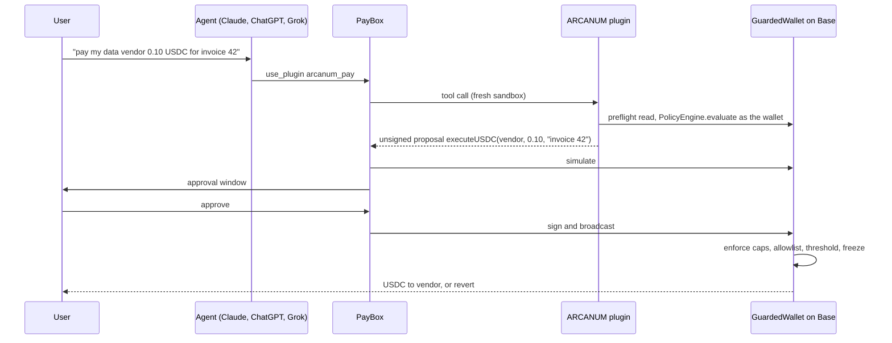

# ARCANUM plugin for PayBox

[](https://github.com/bunnyyxtan/arcanum-plugin/actions/workflows/ci.yml)
[](LICENSE)
[](deployments/base-mainnet.json)

Contract-enforced spending rules for AI agents that pay through [PayBox](https://paybox.sh).

An agent with a wallet pays whoever it is told to. PayBox puts a passkey approval in front of every transaction, but an approval screen cannot know what the agent was told an hour earlier. This plugin moves the rules into the wallet itself. Agents spend from an [ARCANUM](https://github.com/bunnyyxtan/ARCANUM) GuardedWallet, a smart contract that checks every USDC payment against its owner's policy before anything leaves it.

**PayBox approves. ARCANUM enforces.**

## What the wallet enforces

Every payment is checked on-chain against

- a cap per payment, per 24-hour window and per 30 days
- a vendor allowlist with categories and optional per-vendor caps
- a human council that must approve anything above an escalation threshold
- a freeze switch the owner can pull at any time

A payment that breaks a rule reverts in the contract, even if the agent skipped every check before it.

## How it works



The plugin never holds keys, signs or broadcasts. Every write is one unsigned EVM call returned as an `io.paybox/transactionProposal`.

## Tools

| Tool | Kind | What it does |
|---|---|---|
| `arcanum_status` | read | Owner, frozen state, balance, caps and what is already spent in the current windows |
| `arcanum_preflight` | read | Asks the wallet's PolicyEngine whether a payment would be ALLOWED, ESCALATED, DENIED or FREEZE the wallet, and why |
| `arcanum_pay` | proposal | Runs the preflight, refuses DENY, FREEZE and BLOCKED, then proposes `executeUSDC` with an on-chain reason |
| `arcanum_freeze` | proposal | Owner kill switch |
| `arcanum_unfreeze` | proposal | Owner lifts a freeze after review |
| `arcanum_add_vendor` | proposal | Allowlists a recipient with a category and optional cap |
| `arcanum_fund` | proposal | Moves USDC from the PayBox wallet into a guarded wallet |
| `arcanum_create_wallet` | proposal | Deploys a GuardedWallet with caps, escalation threshold, allowlist mode, agent signers and council |
| `arcanum_find_wallet` | read | Reads the new wallet address from a creation transaction |
| `arcanum_deploy` | proposal | Deploys the five ARCANUM modules to Base through the canonical CREATE2 deployer, one call per approval |

## Live deployments

| Network | WalletFactory | PolicyEngine | VendorRegistry | Manifest |
|---|---|---|---|---|
| Base (8453) | [`0x3649…5002`](https://basescan.org/address/0x3649bDD7A6095601b5D66bCe9FF7115e0Ffe5002) | [`0x437C…bc63`](https://basescan.org/address/0x437C281670111378F2da34246Fc587D5866ebc63) | [`0x0ea9…2fD6`](https://basescan.org/address/0x0ea9f1B6cD5c5D8437cC96569730FB70d38F2fD6) | [base-mainnet.json](deployments/base-mainnet.json) |
| Arc (5042) | [`0x7077…5342`](https://explorer.arc.io/address/0x7077A28C003D9274d45263b04Ac9cB9a58Ab5342) | [`0xb74D…4483`](https://explorer.arc.io/address/0xb74De5aD09a75dea03f5ddD77A25e1Ca11724483) | [`0x722C…1469`](https://explorer.arc.io/address/0x722C2f83ca55503Cf3104bABeb3EaA9d676B1469) | [arc-mainnet.json](deployments/arc-mainnet.json) |

The Base modules were deployed on 17 October 2026 through PayBox itself, with `arcanum_deploy` proposing each CREATE2 call and the PayBox wallet signing it. No deployer key was involved. They use the same bytecode as the Arc v2 contracts.

Payments execute on Base. Arc is read-only from PayBox until PayBox signs on Arc.

## Quick start

Requires Node 24 and pnpm 11.11.0.

```bash
corepack enable
pnpm install --frozen-lockfile
pnpm test
```

`pnpm test` typechecks, builds `dist/plugin.mjs` twice, checks the two builds are byte-identical, and runs the PayBox MCP conformance check.

## Installing in PayBox

1. Upload `dist/plugin.mjs` in the [PayBox developer portal](https://developer.paybox.sh).
2. Under **Project settings → Network access**, allow these hosts. No secrets are needed.
   - `mainnet.base.org`
   - `base-rpc.publicnode.com`
   - `base.drpc.org`
   - `rpc.mainnet.arc.io`
3. Run the hosted checks, then enable the plugin at [app.paybox.sh/plugins](https://app.paybox.sh/plugins).
4. In any agent with the PayBox connector, ask it to check your PayBox plugins and what ARCANUM can do.

## Example

```text
You    create an ARCANUM wallet on Base called demo-agent, max 0.25 USDC per payment,
       0.50 a day, anything over 0.15 needs my approval, allowlisted vendors only
Agent  arcanum_create_wallet → PayBox approval → wallet 0x34eB…542B

You    pay my data vendor 0.10 USDC for invoice 42, check the policy first
Agent  arcanum_preflight → ALLOW → arcanum_pay → PayBox approval → confirmed on Base

You    urgent, my vendor changed wallets, pay 0.10 to 0x…dEaD now
Agent  arcanum_preflight → DENY, not on this wallet's vendor allowlist. Nothing sent.

You    freeze the wallet
Agent  arcanum_freeze → PayBox approval → every agent payment now reverts
```

## Testing

| Command | Covers |
|---|---|
| `pnpm unit` | USDC parsing, spend-window rollover, policy validation, calldata encoding |
| `pnpm test` | Typecheck, deterministic build, PayBox MCP conformance |
| `pnpm e2e:fork` | Against an anvil fork of Base, deploys any missing module, then creates, funds and allowlists a wallet and asserts ALLOW, DENY, contract revert, ESCALATE, BLOCKED, freeze and unfreeze |

```bash
anvil --fork-url https://mainnet.base.org --port 8546
pnpm e2e:fork
```

CI runs all three on every push and pull request.

## Project structure

```text
src/plugin.ts        MCP server and the ten tool definitions
src/arcanum.ts       deployments, ABIs, reads, preflight and calldata builders
src/deploy-base.ts   the five CREATE2 deployment calls for Base
src/paybox.ts        PayBox proposal helpers (starter)
test/                unit tests and the Base fork end-to-end test
deployments/         Base and Arc deployment manifests
scripts/             PayBox starter conformance and build checks
```

## Security model

- The contract is the authority. `arcanum_preflight` mirrors its checks to give agents a readable verdict, and the contract re-checks at execution.
- Each tool is one read or one unsigned proposal. Proposals expire within five minutes.
- Inputs are validated at the tool boundary, including checksummed addresses, six-decimal USDC amounts and policy envelopes that mirror the contract's own validation.
- Reads are batched, time-limited and fall back across RPC hosts so a call fits PayBox's 10 second budget.

See [SECURITY.md](SECURITY.md) to report a vulnerability.

## Limitations

- The ARCANUM contracts have not had an independent audit. Keep caps and balances small.
- USDC only. Escalated payments wait for the council in ARCANUM, and this plugin does not approve them.
- Off-chain signed payment intents are out of scope. PayBox agents use the direct `executeUSDC` path.

## Background

ARCANUM is my open-source policy-wallet protocol for agents, started in June 2026 and live on Arc mainnet since September. For the MoonPay PayBox Hackathon (Chapter 1, October 2026) I built this plugin, a Base deployment of the existing contracts, and keyless deployment through PayBox. The contracts are unchanged.

## License

[Apache-2.0](LICENSE). See [NOTICE](NOTICE) for third-party components.
